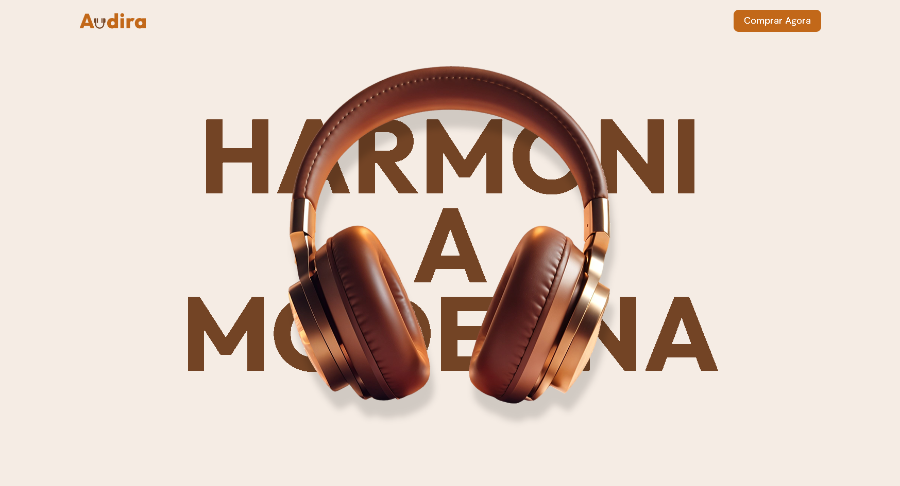
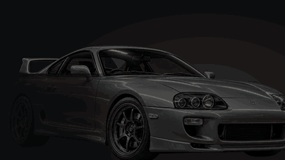
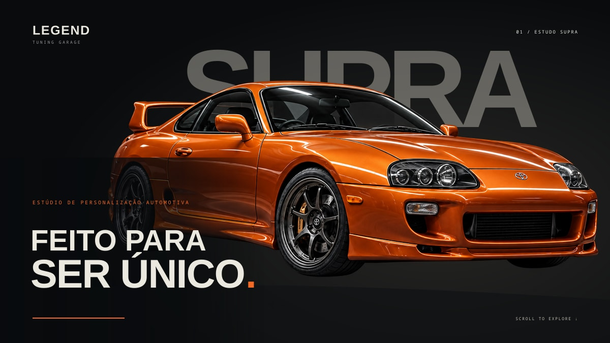

# 🌐 Web Projects Collection

This repository is a curated collection of complete web projects I developed while studying front-end development and user interface design.

Each project is fully finished, responsive and deployed, representing my evolution building real websites from scratch.

---

## 🎯 Purpose of this Repository

Instead of keeping dozens of small repositories, this repo gathers my main **complete website projects** in one place as a portfolio of front-end work.

The focus of these projects includes:

- Modern UI and animations
- Responsive layouts
- Landing pages and institutional websites
- Interactive components
- Realistic website structures

---

## 🚀 Projects

<strong>1. Audira</strong>

### Description
Headphones Website using GSAP animation

---

<strong>2. LEGEND Tuning</strong>

### Description
A cinematic concept website for a tuning studio, featuring a GSAP-powered Supra transformation from black to orange, dramatic lighting, and editorial details.

---

<strong>3. Project Name</strong>

### Description
Short explanation of the website.

🔗 Live demo: LINK_AQUI

---

## 🛠️ Technologies Used

- HTML
- CSS
- JavaScript
- React
- Tailwind
- GitHub Pages

---

## 👨‍💻 Author

Arthur Andre Almeida Santos
